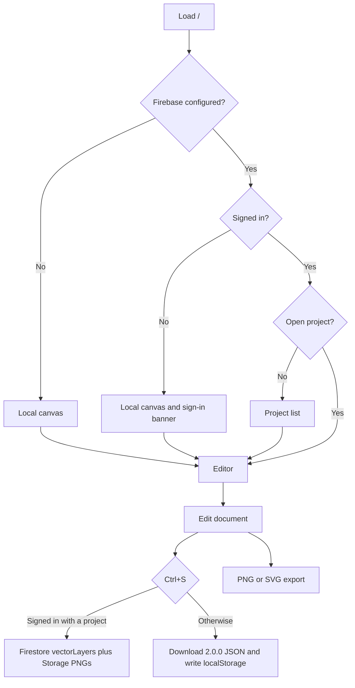

# spec.md — OpenPaint product specification

What the app is and what it does today. Next work, known bugs, and open issues live in `roadmap.md`. Agent commands and git workflow live in `AGENTS.md`.

**Last aligned with the codebase:** 2026-10-28 on `dev`.

## 1. Product

OpenPaint is a free, web-based vector design tool for everyday screen graphics: logos, icons, diagrams, and simple UI assets. Anyone can open the URL and draw. Sign-in is optional and unlocks a cloud project list, auto-save, and thumbnails.

### Users

- Hobbyists and students learning vector basics
- Developers and PMs who need a quick diagram or icon
- Designers who want a lightweight browser tool for simple jobs

### Workflows

1. Open `/` and draw. Firebase sign-in is optional.
2. Select an object and move, resize, or nudge it. Edit fill, stroke, opacity, and rotation in the Properties panel.
3. Organize work in layers. Reorder layers and objects. Lock or hide them.
4. Undo and redo.
5. Save. Signed-in users with an open project write to Firebase. Everyone else downloads a JSON file and keeps a browser backup.
6. Export a PNG composite or an SVG.

### Goals

- Editable vector objects, not burned-in pixels.
- A short path from opening the page to the first shape.
- Reliable cloud save for signed-in users.
- One scene graph and one canvas path.

### Out of scope

| Area | Reason |
| --- | --- |
| CMYK and print prepress | Web RGB |
| AI generative features | Not part of the editor |
| Real-time multiplayer | Separate architecture |
| Full Illustrator parity | Out of proportion to the product |

## 2. Application as built

Single-page Next.js app. The editor is `src/app/page.tsx`. `layout.tsx` wraps `AuthProvider`. There are no API routes and no Firebase Admin SDK. Auth, Firestore, and Storage use the client SDK. Firestore and Storage rules enforce ownership.

Extra routes: `/login`, `/signup`, `/forgot-password`.

### Feature inventory

| Feature | Status | Behavior |
| --- | --- | --- |
| Vector model | Working | `rectangle`, `ellipse`, `line`, `polygon`, `path`, `text`, `group`, `image` |
| Rendering | Working | Canvas 2D scene graph. Solid and gradient fills draw if present on an object |
| Selection (V) | Working | Click, marquee, move, 8-handle resize, delete, arrow nudge. Handles use the object's transform |
| Shapes (R, O, L, polygon) | Working | Drag to create. Polygon has no letter shortcut |
| Pen (P) | Working | Corner and smooth points, close path, Enter or Escape |
| Brush (B) | Working | Freehand stroke becomes a smoothed cubic path |
| Eraser (E) | Partial | Deletes the object under the cursor |
| Fill (G) | Partial | Sets a solid fill on the object under the cursor |
| Eyedropper (I) | Working | Samples fill or stroke into the tool defaults |
| Text (T) | Working | Inline editor. Double-click a text object to edit it again |
| Properties | Working | Single selection: name, position, size, rotation, opacity, fill, stroke |
| Layers | Working | Visibility, lock, delete, drag-reorder of layers and objects. Those edits are undoable |
| Undo / redo | Working | Operation history on `documentStore`, capped at 200 entries |
| Zoom / pan | Working | Ctrl/Meta + wheel. Middle-mouse pan |
| PNG export | Working | Ctrl+E. White background composite |
| SVG export | Working | Ctrl+Shift+E. Solid and gradient fills, per-corner radii, groups. Numbers and image URLs are constrained |
| Groups | Model only | Renderer and SVG export understand `group`. No Ctrl+G UI |
| Direct selection | Not built | Anchors cannot be edited after a path is created |
| Gradient UI | Not built | Types, renderer, and SVG export already accept gradients |
| Rotation handle | Not built | Rotation is a number in Properties |
| Cloud projects | Working | CRUD, thumbnails, `vectorLayers` JSON plus per-layer PNGs |
| Auto-save | Working | Debounced save when a signed-in user has a project open and the document is dirty |
| Guest entry | Working | Unsigned users draw immediately. A dismissable banner offers cloud sign-in |
| Local project | Working | Save downloads version `2.0.0` JSON and writes `localStorage` key `openpaint-project`. Open reads a JSON file whose `version` starts with `2`. Refresh restores the `localStorage` copy for guests |
| Legacy raster import | Working | Cloud projects with no `vectorLayers` and existing layer PNGs import as locked `image` objects |
| Auth | Working | Google, email/password, email link (prompts when the email is not stored), password reset. Sign-out and account switch clear the editor before a guest document can attach to the previous project |
| Security headers | Working | CSP, `X-Frame-Options: DENY`, and `Referrer-Policy` from `next.config.ts` |
| Tests | Partial | Vitest covers helpers, export, history, auth/session, headers, and project loading. Pointer interaction on the canvas is not covered |

### Save and open

Cloud save uploads layer PNGs and a thumbnail, then writes the scene. Browser uploads need the Storage bucket CORS to allow the page origin. Reopening a vector project reads `vectorLayers` from Firestore and does not need that CORS. Reopening a legacy raster project fetches Storage images and does.

Canvas size is stored as integers from 1 to 4096.

### Architecture

- React 19 and Tailwind CSS 4.
- Zustand: `documentStore` (scene and history), `canvasStore` (tool, zoom, pan, fill/stroke defaults, plus unused raster maps), `projectStore`, `authStore`.
- `VectorCanvas` stacks a scene canvas, a selection overlay, and a pointer canvas.
- Document edits call `markDocumentDirty()` so auto-save can run.

### Constraints

- Client-only Firebase. Every `NEXT_PUBLIC_` value is visible in the browser.
- No service worker.
- No project dashboard route. The project list is a modal.
- Desktop layout. Sidebars are fixed widths.
- `canvasStore` still holds raster-era canvas maps. `VectorCanvas` does not use them.

## 3. Related documents

| File | Role |
| --- | --- |
| `roadmap.md` | Next steps, known bugs, open issues |
| `AGENTS.md` | Commands, stores, and git workflow |
| `README.md` | Install and environment variable names |
